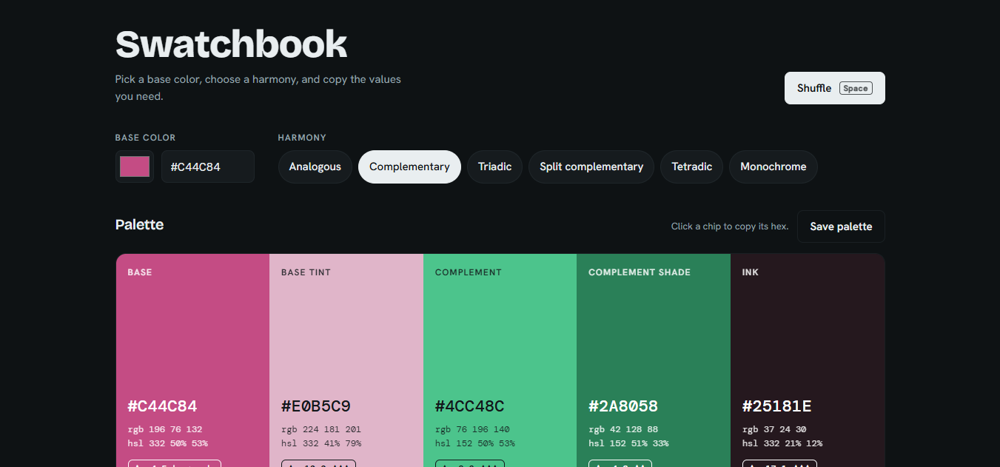

# Swatchbook

A color palette generator for designers and developers. Pick a base color, choose a harmony, and copy the values you need.



<!-- Replace screenshot.png with a real screenshot of the app, or delete the line above. -->

## Features

- **Six harmony modes:** analogous, complementary, triadic, split complementary, tetradic and monochrome.
- **Click to copy:** click any chip to copy its hex code. Each chip also shows its RGB and HSL values.
- **Shade scale:** ten steps (50 to 900) built from your base hue.
- **Text contrast table:** every palette color checked as text against every other, with WCAG 2.1 ratings (AA, AAA, large text only).
- **Export:** copy the palette as CSS variables, JSON or a Tailwind config.
- **Saved palettes:** keep favorites in your browser with `localStorage`.
- **Light and dark themes:** follows your system setting.
- **Responsive:** works on phones and desktops.
- **Shuffle:** press the spacebar or the Shuffle button for a new base color.

## Getting started

There is no build step and nothing to install.

1. Download or clone this repository.
2. Keep `index.html`, `styles.css` and `script.js` in the same folder.
3. Open `index.html` in your browser.

An internet connection is needed for the Google Fonts (Bricolage Grotesque, DM Mono and Hanken Grotesk). Without it the page falls back to system fonts.

## Project structure

```
swatchbook/
├── index.html   # page structure and empty containers
├── styles.css   # color tokens, layout, dark mode, responsive rules
└── script.js    # color math, harmonies, contrast, rendering, events
```

## How it works

- The app keeps three values in a `state` object: the base color, the harmony mode and the export format. Every change calls `render()`, which rebuilds the whole interface from that state.
- Colors are converted from hex to RGB to HSL. Harmonies are hue rotations on the color wheel, for example the complement of a color is its hue plus 180 degrees.
- Contrast uses the WCAG 2.1 formula: `(L1 + 0.05) / (L2 + 0.05)`, where `L1` is the lighter and `L2` the darker relative luminance. A ratio of 4.5 passes AA for body text and 7 passes AAA.

## Customizing

**Add a harmony.** Add an entry to the `MODES` object in `script.js`. It appears as a new button automatically.

```js
square: {
  label: 'Square',
  make: (h, s, l) => [
    [h, s, l, 'Base'],
    [rot(h, 90), s, l, 'Quarter'],
    [rot(h, 180), s, l, 'Opposite'],
    [rot(h, 270), s, l, 'Three quarter'],
    [h, Math.min(s, 14), 95, 'Paper']
  ]
}
```

**Change the starting color.** Edit `base` in the `state` object at the top of the app section in `script.js`.

**Change the look.** Edit the color and font variables at the top of `styles.css`.

## Publish with GitHub Pages

1. Push the repository to GitHub.
2. Go to **Settings**, then **Pages**.
3. Under **Build and deployment**, choose **Deploy from a branch**, select `main` and `/ (root)`, and save.
4. The site will be live at `https://YOUR-USERNAME.github.io/swatchbook/`.

## Built with

HTML, CSS and vanilla JavaScript. No frameworks or dependencies.

## License

Add a license of your choice before sharing. [MIT](https://choosealicense.com/licenses/mit/) is a common option for small projects like this.
